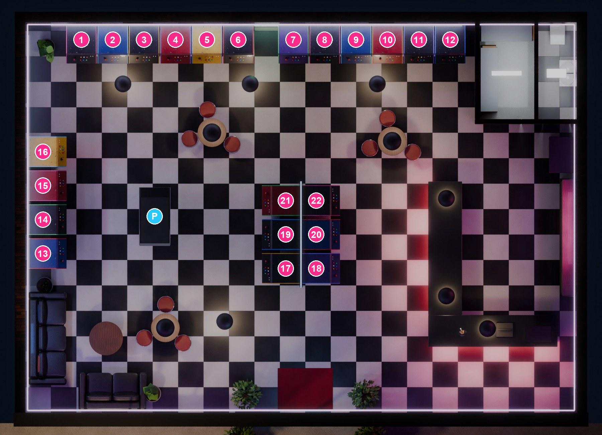

# Arcade de la clase

Un local arcade en 3D que se recorre desde el navegador. Cada una de sus **22 máquinas** puede abrir un juego
hecho por un estudiante en **pygame-ce**, compilado a WebAssembly con **pygbag**. Todo es estático: se publica gratis
en GitHub Pages, sin servidor ni base de datos.

```
index.html, app.js      el visor 3D (three.js)
modelo/                 el local (arcade.glb), sus personajes (empleado.glb, jugador.glb) y sus mapas de luz
juegos.json             qué juego va en cada máquina  ← lo único que se edita a mano
juegos/<nombre>/        un juego compilado por carpeta (salida de pygbag)
ejemplos/serpiente/     código fuente del juego de ejemplo, como plantilla
mapa_maquinas.jpg       planta del local con el número de cada máquina
```

## 1. Preparar el juego (estudiante)

pygbag ejecuta Python dentro del navegador, así que el juego necesita tres cosas:

1. El archivo principal se llama **`main.py`** y está en la carpeta del juego, junto con sus imágenes, sonidos y fuentes.
2. El bucle principal es **`async`** y cede el control al navegador en cada fotograma:

   ```python
   import asyncio
   import pygame

   async def main():
       pygame.init()
       pantalla = pygame.display.set_mode((640, 480))
       reloj = pygame.time.Clock()
       while True:
           for evento in pygame.event.get():
               ...
           # lógica y dibujo
           pygame.display.flip()
           reloj.tick(60)
           await asyncio.sleep(0)      # imprescindible: sin esto el navegador se congela

   asyncio.run(main())
   ```

3. Rutas **relativas** a la carpeta del juego (`"img/nave.png"`, nunca `C:\...`).

Conviene además:

- Resolución **4:3** (640×480 u 800×600): es la forma de la pantalla de la máquina.
- Sonidos en **`.ogg`** (los `.wav`/`.mp3` pueden fallar en algunos navegadores).
- Evitar `time.sleep()`, `input()`, hilos y `sys.exit()`; salir del juego no hace falta (la máquina se cierra con *Esc*).

Hay dos ejemplos completos: `ejemplos/serpiente/main.py` (máquina 7) y `ejemplos/pinball/` (el pinball del local:
la física está separada en `mesa.py`, así se puede probar sin abrir ventana).

## 2. Compilar con pygbag

```bash
pip install pygame-ce pygbag
python -m pygbag mi_juego
```

Eso compila y abre una prueba en `http://localhost:8000`. Si funciona ahí, funcionará en el arcade.
Para generar solo los archivos:

```bash
python -m pygbag --build mi_juego
```

La salida queda en `mi_juego/build/web/` (`index.html`, `mi_juego.apk`, `favicon.png`…). Copia **el contenido** de esa
carpeta a `juegos/mi_juego/` de este repositorio.

En **Windows**, si pygbag falla con `UnicodeDecodeError: 'charmap' codec can't decode...`, es porque el código tiene
tildes, eñes o símbolos y Python lo lee con la codificación antigua. Compila así (PowerShell):

```bash
$env:PYTHONUTF8 = "1"; python -m pygbag --build mi_juego
```

## 3. Asignarlo a una máquina

Añade una entrada en `juegos.json`:

```json
{
  "maquina": 8,
  "titulo": "Space Pong",
  "autor": "Ana y Leo",
  "url": "juegos/space_pong/index.html",
  "portada": "juegos/space_pong/portada.png",
  "controles": "W/S y flechas. Espacio para sacar."
}
```

| Campo | Qué es |
|---|---|
| `maquina` | Número de 1 a 22, o `"pinball"` para la mesa de pinball. Al pasar el ratón por una máquina se ve su número; también están en `mapa_maquinas.jpg` (el pinball es la **P**). |
| `aspecto` | Opcional. Forma de la pantalla del juego, por defecto `"4/3"`. Para juegos verticales, como el pinball, `"3/4"`. |
| `titulo` | Aparece en la marquesina luminosa, en la pantalla y en la lista de juegos. |
| `autor` | Nombre del estudiante o del equipo. |
| `url` | Ruta al `index.html` de la build. |
| `portada` | Opcional. Captura del juego (mejor 4:3) que se muestra en la pantalla de la máquina. |
| `controles` | Opcional. Se muestra debajo del juego. |



Las máquinas sin entrada muestran “PRÓXIMAMENTE”. Si el arcade aparece sin juegos, revisa que `juegos.json`
sea JSON válido (comas entre entradas, comillas dobles): el error se ve en la consola del navegador (F12).

## 4. Probar el arcade en tu ordenador

Desde esta carpeta:

```bash
python -m http.server 8080 --bind 127.0.0.1
```

y abre **`http://127.0.0.1:8080`**. Usa `127.0.0.1` y no `localhost`: cuando la dirección contiene `localhost`,
pygbag cree que está en su servidor de desarrollo y busca pygame en `localhost:8000`, así que el juego no arranca.
En GitHub Pages esto no ocurre.

## 5. Publicar en GitHub Pages

1. Sube esta carpeta a un repositorio de GitHub (`git add . && git commit -m "Nuevo juego" && git push`).
2. En el repositorio: **Settings → Pages → Branch: `main` / `(root)` → Save**.
3. En un par de minutos estará en `https://<usuario>.github.io/<repositorio>/`.

Para añadir más juegos después basta con repetir los pasos 2 y 3 y hacer *push*. Cada build de pygbag pesa poco
(el intérprete de Python se descarga una sola vez desde el CDN de pygame-web y queda en caché).
Los límites de GitHub Pages (1 GB por sitio, 100 GB de tráfico al mes) sobran para una clase.

## Personajes

Para que el local no se vea vacío hay dos personajes animados:

- **El empleado de la barra** limpia el mostrador, saluda cuando te acercas y te sigue con la mirada. Si le haces
  clic, da consejos y recomienda los juegos que estén asignados en `juegos.json`.
- **Un jugador** que juega en una máquina **sin juego asignado** (de preferencia la 10). Si el profe le asigna un
  juego a esa máquina, el jugador se cambia solo a otra libre; si todas tienen juego, no aparece. Mientras juega,
  su máquina está ocupada.

Los personajes están hechos con [MakeHuman](http://www.makehumancommunity.org) y animados por código; parpadean,
sonríen al saludar, mueven la boca al hablar y siguen al jugador con la mirada. No hace falta tocarlos para añadir juegos.

Créditos: recursos de MakeHuman en CC0 (pieles, ojos, ropa, pelo del jugador; cejas y pestañas de Mindfront), salvo el
pelo del empleado, *Grump Hair* de **Elvaerwyn** (licencia CC BY, paquete
[hair02](https://static.makehumancommunity.org/assets/assetpacks/hair02.html)), recoloreado a castaño.

## Controles del recorrido

- **Ordenador:** `W A S D` para caminar, `← →` para girar, arrastrar para mirar, clic en el suelo para ir a ese punto,
  clic en una máquina para jugar. *Esc* sale del juego.
- **Móvil:** arrastrar para mirar, tocar el suelo para caminar, tocar una máquina para jugar.
